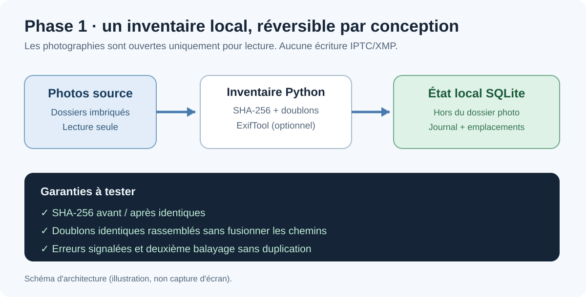

# GNU Automatic Picture Metadata generator (GNU APMG)

> **Pré-alpha 0.2.0a1 : premier moteur d’inventaire disponible.** La Phase 1 est implémentée et testée sur des données fictives ; un pilote de 200 copies privées a été validé en lecture seule, dont 100 HEIC. La Phase 2 dispose de commandes expérimentales de préparation, vision locale et OCR CPU ; sa qualité reste à évaluer humainement.

**Licence : [GNU General Public License version 3 (GPL-3.0-only)](COPYING).** Projet public dès son premier commit ; aucun fichier privé ou photographie personnelle dans Git.

Dépôt : [steveprudhomme/gnu-apmg](https://github.com/steveprudhomme/gnu-apmg). Ancien nom : PhotoSémantique. Le module Python conserve ce nom pour compatibilité. Le nom du projet ne revendique aucun rattachement officiel à GNU.


Validation du 15 novembre 2026 : **ExifTool 13.63 réel**, 19 tests réussis et 2 ignorés. Deux scans sur **100 HEIC, 50 JPG et 50 PNG** : zéro erreur et empreintes originales inchangées. La compatibilité HEIC concerne ici les métadonnées et le hachage ; affichage, conversion et analyse IA restent à valider.

Relancer les tests : `& .\scripts\Test-ExifTool.ps1` depuis PowerShell à la racine du dépôt. [Résultats et tutoriel](docs/tutorial/phase-1.md).

## Phase 2 expérimentale

Préparation HEIC vérifiée sur 10 copies. OCR réel testé sur une mire et 3 dérivés HEIC. Vision Qwen3-VL 8B : 2 dérivés HEIC sur 3 acceptés ; une réponse tronquée est explicitement refusée. Toutes les observations restent des propositions. **29 tests locaux : 27 réussis, 2 ignorés.**

[Guide illustré et scripts Phase 2](docs/tutorial/phase-2.md). Les modèles et dépendances optionnelles sont installés séparément ; aucun média ni modèle binaire dans Git.

## Mission

Inventorier récursivement des photographies en lecture seule, analyser localement les scènes, objets et textes, puis préparer un enrichissement documentaire pérenne au moyen des standards IPTC/XMP et d'une base de connaissances locale. L'IA doit proposer ; un humain confirme les éléments incertains. Tous les calculs et les données privées restent sur l'ordinateur de l'utilisateur.

## Ce que le projet ne fait pas

- Il n'envoie **aucune** photographie, empreinte faciale ou coordonnée GPS à une API externe ; aucun géocodage public par défaut.
- Il ne prétend pas identifier une personne, une adresse précise ou un modèle d'objet avec certitude.
- Il ne modifie pas les images originales pendant les phases 1 et 2.
- Il ne remplace pas digiKam ou Immich comme galerie ; il vise l'interopérabilité avec des outils existants.
- Il offre une CLI d’inventaire pré-alpha ; l’interface web et la vidéo de démonstration restent à réaliser.

## Cible technique

Windows 11, Python **3.12+** et ExifTool pour la Phase 1. La CLI d’inventaire s’exécute également sur d’autres systèmes avec Python ; les tests automatiques ciblent Windows et Linux. Phase 2 expérimentale : Ollama et NVIDIA RTX 4070 / 12 Go VRAM, description locale (Qwen3-VL 8B quantifié) et OCR PaddleOCR. Les versions de ces outils devront être verrouillées avant leur distribution.

## Architecture en bref

Interfaces contractuelles de ligne de commande ou de processus : `inventory -> observations -> validation -> export`. Chaque composant peut être exécuté, remplacé, testé et mis à jour indépendamment ; aucune importation circulaire. Le modèle de données conserve les informations d'origine, les observations IA et la validation humaine séparément.

## Démarrer la Phase 1

Depuis la racine du dépôt, avec Python 3.12+ et ExifTool installé localement :

```powershell
py -m photosemantique scan "C:\Photos\Pilote" --db "C:\PhotoSemantique-Etat\inventaire.sqlite" --exiftool "C:\Outils\ExifTool\exiftool.exe"
py -m photosemantique report --db "C:\PhotoSemantique-Etat\inventaire.sqlite"
py -m unittest discover -s tests -p 'test_*.py'
```

Pour tester sans ExifTool, `--no-exif` effectue l'inventaire **sans extraction documentaire**, ce qui est explicitement indiqué dans les résultats. La base doit être placée **en dehors du répertoire photo et du dépôt Git**. Le programme ne suit pas les liens symboliques et conserve séparément les chemins et les empreintes SHA-256.

**[Tutoriel illustré étape par étape](docs/tutorial/phase-1.md)** : explications, diagrammes SVG, exécution synthétique vérifiée et contrôle d’intégrité PowerShell.



## Exemple de sortie conceptuelle de Phase 2 (non généré)

```json
{"photo_id":"sha256:<empreinte>","observation":{"type":"object","concept":"aircraft","label_fr":"avion","source":"qwen3-vl-8b","status":"suggested","confidence":null},"text_ocr":[{"literal":"C-FABC","status":"suggested"}]}
```

La confiance n'est pas une probabilité calibrée par défaut : `null` signifie absence d'étalonnage. Le code ne doit pas transformer une hypothèse en fait acquis.

## Installer, contribuer, vérifier

- [INSTALL.md](INSTALL.md) — préparation et limites de l'installation.
- [ROADMAP.md](ROADMAP.md) — objectifs, critères de succès, responsables.
- [Architecture](docs/architecture/overview.md) — modules et contrats.
- [Protocole pilote](docs/validation/pilot-protocol.md) — 100 à 200 photographies privées, hors Git.
- [CONTRIBUTING.md](CONTRIBUTING.md), [GOVERNANCE.md](GOVERNANCE.md), [SECURITY.md](SECURITY.md).
- [Sources, licences et réserves](docs/legal/licenses.md).

**Courte vidéo de démonstration (maximum 4 min) :** non disponible à ce stade. [Storyboard et critères de publication](docs/demo/README.md). Aucun faux lien vidéo.

## À propos de la licence

Tout code original du projet est proposé sous `GPL-3.0-only`. Les outils tiers ne changent pas de licence ; leurs obligations sont recensées séparément. La compatibilité d'un ensemble distribué n'est pas automatiquement garantie par la présence d'une licence compatible sur une page d'accueil.
