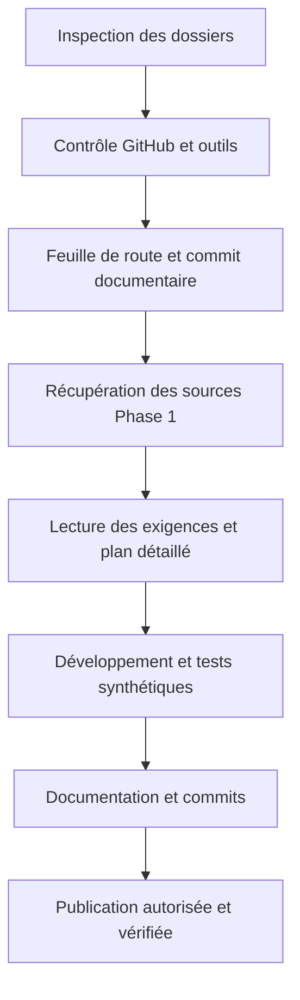

# Tutoriel illustré de reprise

Projet : **GNU Automatic Picture Metadata generator (GNU APMG)**, anciennement PhotoSémantique.

Le nom est mis à jour dans README.md, ROADMAP.md et ce tutoriel. Les références historiques au bundle et à l'ancien dépôt sont conservées pour retrouver les sources. La création du dépôt `steveprudhomme/gnu-apmg` a été demandée ; son résultat sera consigné après vérification.

## Parcours

Ce schéma décrit le parcours ; il ne prouve pas l'exécution des étapes futures.

## Journal du 13 novembre 2026

| Action | Résultat observé |
| --- | --- |
| Lister les fichiers cachés et visibles du dossier de développement | Dossier vide |
| Lister le second espace OneDrive | Dossier vide |
| Lire la conversation référencée | Cinq échanges accessibles ; aucune pièce jointe ; historique plus ancien indisponible via le curseur |
| Interroger le dépôt GitHub avec la connexion disponible | Réponse 404, existence non confirmée |
| Vérifier Git, GitHub CLI et Python | Outils disponibles, versions dans ROADMAP.md |
| Vérifier la connexion GitHub locale | Authentification invalide |
| Chercher archive et bundle | Aucun livrable correspondant dans les espaces ciblés ou à la racine de Téléchargements ; recherche générale interrompue |
| Créer les documents de reprise | README.md, ROADMAP.md et ce tutoriel |

## Reprendre depuis les sources

Placer les livrables récupérés dans le dossier parent du projet ou fournir leur chemin exact. Le bundle annoncé porte le nom `photosemantique-phase1-v0.2.0a1-history.bundle`. Il doit être vérifié avant restauration. L'archive et le bundle n'ont pas encore été ouverts ici.

La prochaine étape consiste à récupérer les exigences et à détailler les fonctions attendues dans ROADMAP.md. Le développement commencera après le commit de ce plan confirmé.

Les illustrations des futures fonctions utiliseront des données synthétiques. Aucune capture de photo privée ni de contenu d'authentification ne sera intégrée.
