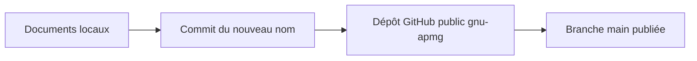
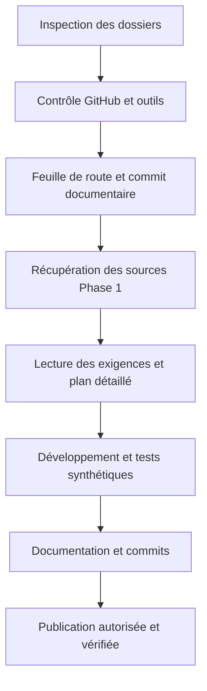

# Tutoriel illustré de reprise

Projet : **GNU Automatic Picture Metadata generator (GNU APMG)**, anciennement GNU APMG.

Le nom est mis à jour dans README.md, ROADMAP.md et ce tutoriel. Les références historiques au bundle et à l'ancien dépôt sont conservées pour retrouver les sources.

## Création du dépôt GNU APMG

Le commit `ba484a5` enregistre le nouveau nom. La commande suivante a ensuite créé le dépôt public et publié les documents :

```powershell
gh repo create steveprudhomme/gnu-apmg --public --description "GNU Automatic Picture Metadata generator (GNU APMG)" --source . --remote origin --push
```

Résultat observé : URL du dépôt retournée, branche main publiée et suivi origin/main configuré. La commande a réussi avec l'accès réseau autorisé, malgré le diagnostic d'authentification initial dans l'environnement restreint. Aucun renouvellement de jeton n'a été nécessaire.



## Parcours



Ce schéma décrit le parcours ; il ne prouve pas l'exécution des étapes futures.

## Journal du 13 novembre 2026

| Action | Résultat observé |
| --- | --- |
| Lister les fichiers cachés et visibles du dossier de développement | Dossier vide |
| Lister le second espace OneDrive | Dossier vide |
| Lire la conversation référencée | Cinq échanges accessibles ; aucune pièce jointe ; historique plus ancien indisponible via le curseur |
| Interroger le dépôt GitHub avec la connexion disponible | Réponse 404, existence non confirmée |
| Vérifier Git, GitHub CLI et Python | Outils disponibles, versions dans ROADMAP.md |
| Vérifier la connexion GitHub locale | Authentification invalide |
| Chercher archive et bundle | Aucun livrable correspondant dans les espaces ciblés ou à la racine de Téléchargements ; recherche générale interrompue |
| Créer les documents de reprise | README.md, ROADMAP.md et ce tutoriel |

## Reprendre depuis les sources

Placer les livrables récupérés dans le dossier parent du projet ou fournir leur chemin exact. Le bundle annoncé porte le nom `photosemantique-phase1-v0.2.0a1-history.bundle`. Il doit être vérifié avant restauration. L'archive et le bundle n'ont pas encore été ouverts ici.

La prochaine étape consiste à récupérer les exigences et à détailler les fonctions attendues dans ROADMAP.md. Le développement commencera après le commit de ce plan confirmé.

Les illustrations des futures fonctions utiliseront des données synthétiques. Aucune capture de photo privée ni de contenu d'authentification ne sera intégrée.


## Mise à jour du 14 novembre 2026

Les archives ont été reçues, inspectées puis restaurées après le commit documentaire `2df59b6`. Les étapes « sources manquantes » ci-dessus décrivent uniquement l'état du 13 novembre. La procédure actuelle et les illustrations se trouvent dans le [tutoriel Phase 1](tutorial/phase-1.md).

La feuille de route, le README initial et l'historique Git local ont été préservés. Aucun bundle Git n'a été fourni. Les prompts fondateurs ont été lus, sans être copiés dans le dépôt public.


## Mise à jour du 15 novembre 2026

ExifTool réel et le pilote privé de 200 copies (dont 100 HEIC) sont maintenant vérifiés. Le [tutoriel Phase 1](tutorial/phase-1.md) consigne l’installation, le manque de place résolu, les corrections Unicode/avertissements, les tests, le script PowerShell et le bilan illustré. Les données privées restent hors Git.
