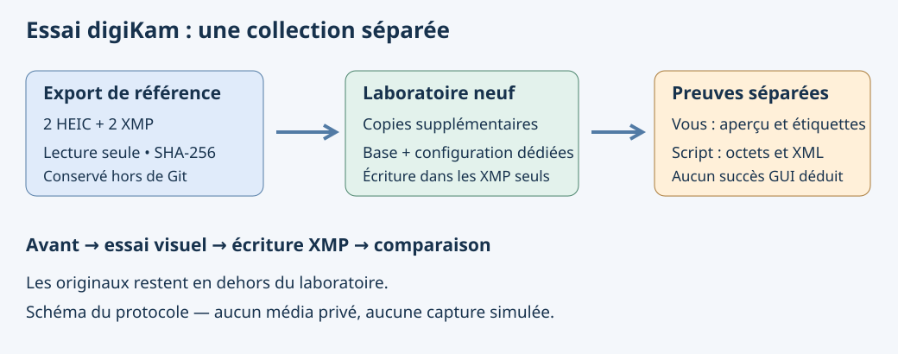

# Essai digiKam sur deux copies HEIC

## 1. Préparation réalisée avant l'essai

Le commit `ed8a94f` a inscrit les sous-étapes D1–D6 avant développement. Aucun défaut de l'export n'a encore été observé dans digiKam ; aucun changement de convention XMP n'est donc appliqué.



Cette illustration est un schéma du protocole, sans photographie privée. Ce n'est pas une capture de digiKam et elle ne prouve pas un essai visuel.

Sur le poste de préparation, digiKam n'a pas été trouvé dans le PATH, les emplacements usuels et les clés de désinstallation consultées. La version portable **9.1.0 Qt6 Windows 64 bits** a été téléchargée depuis KDE, puis extraite après refus des chemins sortants et des liens dans l'archive. SHA-256 :

```text
8177b2b47f753e9b1a4fa87641bc65fda4c2e797eb439c6cca2a3d9bf71b1276
```

Cette empreinte correspond à la [liste publiée par KDE](https://download.kde.org/stable/digikam/9.1.0/digiKam-9.1.0-Qt6-Win64.tar.xz.mirrorlist). La signature détachée a été téléchargée mais **pas vérifiée cryptographiquement**. Le programme et son archive restent hors dépôt ; aucune redistribution du logiciel tiers dans GNU APMG.

Les options `--config` et `--database-directory` ont été confirmées dans le [code source officiel 9.1.0](https://invent.kde.org/graphics/digikam/-/blob/v9.1.0/core/app/main/main.cpp). Le fichier de configuration doit déjà exister et être accessible en lecture/écriture ; le script le crée vide pendant la préparation. L'appel `--help` n'a fourni aucune sortie console exploitable sous Windows ; il ne constitue pas une validation de l'interface.

## 2. Laboratoire privé

Les chemins par défaut sont calculés à partir du dépôt :

```text
<espace de travail>/etat-prive/
  export-xmp-20261115/           référence : ne pas ouvrir dans digiKam
  digikam-lab-20261115/
    collection/                 deux NOUVELLES copies HEIC + leurs XMP
    config/digikamrc             configuration principale dédiée
    database/                   base SQLite dédiée à confirmer dans l'assistant
    baseline.json               empreintes et propriétés XML initiales
    observations.json           résultats visuels à renseigner
    comparison.json             vérification automatique après essai
```

La préparation refuse un laboratoire existant, un chemin dans Git et des paires image/XMP incomplètes. Elle ne relance aucun modèle et n'écrit ni la session de décisions ni le lot de référence. Chaque copie est vérifiée par SHA-256. Les paramètres `-LabDirectory`, `-ReferenceExport` et `-DigiKam` permettent d'adapter les chemins.

**Les copies contiennent toujours les métadonnées intégrées des images. Tous ces fichiers restent privés.** Les options de lancement séparent la configuration principale et la base, mais ne garantissent pas que tous les caches, réglages système ou ressources auxiliaires de digiKam soient confinés au laboratoire. Le répertoire « portable » seul n'isole pas une photothèque.

La préparation a déjà été exécutée pour le laboratoire par défaut. Pour un nouvel essai indépendant, choisir un nouveau dossier :

```powershell
& .\scripts\Invoke-DigiKamLab.ps1 -Action Prepare -LabDirectory 'D:\EtatPrive\digikam-autre-essai'
```

## 3. Lancer et vérifier la lecture

Depuis PowerShell à la racine du dépôt :

```powershell
& .\scripts\Invoke-DigiKamLab.ps1 -Action Open
```

Le lanceur refuse de démarrer si digiKam est déjà ouvert, pour éviter de réutiliser une autre instance. Il affiche les deux chemins à choisir. Dans l'assistant initial :

1. Choisir **uniquement** le dossier `digikam-lab-20261115\collection` comme collection locale. Ne pas sélectionner le dossier parent ni une photothèque personnelle.
2. Confirmer une base **SQLite** dans `digikam-lab-20261115\database`. Si les chemins affichés diffèrent, arrêter avant de poursuivre.
3. Ignorer les téléchargements facultatifs de modèles et ne pas lancer de reconnaissance faciale, recherche d'identités ou géocodage.
4. Dans les réglages des métadonnées, activer la lecture des compagnons XMP. Garder la convention **image.ext.xmp**, sans l'option de noms compatibles avec les logiciels commerciaux (`image.xmp`). Consulter le [manuel des réglages](https://docs.digikam.org/en/setup_application/metadata_settings.html) ; le libellé dépend de la langue de l'application.
5. Vérifier les deux aperçus HEIC puis les étiquettes et leurs arborescences. Les quantités attendues sont quatre concepts sur une photo et trois sur l'autre ; des nœuds parents supplémentaires peuvent apparaître. Un affichage correct des mots-clés plats ne prouve pas la conservation des hiérarchies ou des URI.
6. Renseigner localement `observations.json` : remplacer `not_tested` par `pass`, `fail` ou `not_visible` pour chaque point observé. Noter la version affichée et les anomalies dans `notes`. L'absence d'un panneau affichant AboutCvTerm n'est pas la preuve de la perte des URI.

Si les mots-clés ne sont pas chargés lors du premier scan, utiliser une relecture fichier → base, limitée à cette collection. Ne pas écrire de métadonnées pour tenter de corriger une lecture manquante.

## 4. Aller-retour limité aux compagnons

Après vérification de la lecture :

1. Régler l'écriture des métadonnées **uniquement dans les compagnons XMP**. Éviter le mode écriture dans l'image et le mode combiné. Désactiver la synchronisation différée pour cet essai ; ne pas modifier les étiquettes validées.
2. Utiliser la [synchronisation de maintenance](https://docs.digikam.org/en/maintenance_tools/maintenance_metadata.html), sens base → fichiers, limitée à la collection des deux copies. Contrôler le périmètre et les options avant de lancer l'action.
3. Attendre la fin, fermer digiKam, puis lancer :

```powershell
& .\scripts\Invoke-DigiKamLab.ps1 -Action Compare
```

Le rapport `comparison.json` distingue : intégrité de l'export de référence, octets des images du laboratoire, modification des octets XMP, propriétés XML antérieures modifiées/manquantes et propriétés ajoutées. Il ignore les différences de préfixes XML et d'ordre dans les listes RDF Bag/Alt. Il conserve l'ordre des séquences. Il ne constitue pas un moteur complet d'équivalence RDF : un changement de représentation peut nécessiter une inspection humaine. Les valeurs détaillées restent dans les fichiers privés.

Une comparaison entièrement inchangée **avant** ouverture de digiKam prouve seulement la fidélité des copies. Même après l'essai, des XMP inchangés ne prouvent pas qu'une écriture a été exécutée. Le rapport ne déduit jamais un succès GUI. Un fichier manquant ou XML non pris en charge provoque un refus explicite ; un ancien rapport n'est alors pas un résultat de la nouvelle tentative.

Ne pas appliquer le script d'annulation XMP à ce laboratoire : son journal appartient au lot de référence. Pour recommencer, préparer un autre laboratoire neuf ; conserver celui-ci pour diagnostic si l'aller-retour perd des propriétés.

## 5. Résultats vérifiés et travail restant

Au 15 novembre 2026 : deux nouvelles copies HEIC et deux XMP préparés ; comparaison initiale sans changement des sources, des copies ou des propriétés XMP. Tests synthétiques du laboratoire réussis, y compris détection de perte, image modifiée, référence modifiée, XML interdit et chemins refusés. Les fichiers HEIC synthétiques de ces tests sont des octets fictifs : ils ne testent pas le décodeur digiKam.

**L'affichage HEIC, l'association XMP et l'aller-retour dans digiKam restent à exécuter et à observer.** Le contrôle Windows automatique n'a pas pu démarrer (échec d'initialisation de ses fichiers internes). Aucune capture d'écran réelle ou réussite visuelle n'est revendiquée. Après votre essai, les observations et la comparaison serviront à décider d'une éventuelle correction avec test de régression.
