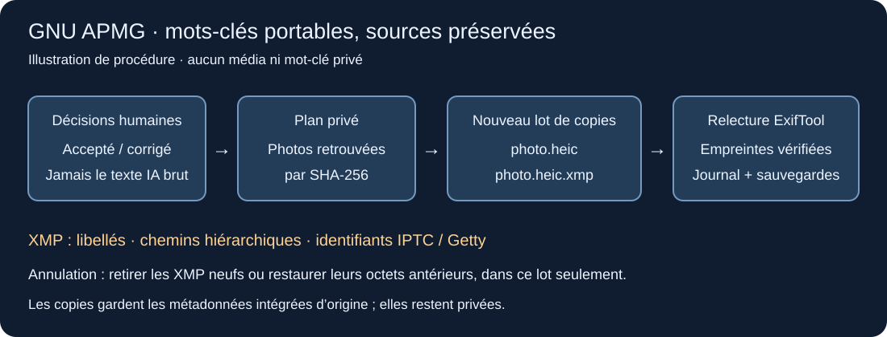

# Export des mots-clés validés en XMP

## 1. Plan préalable et périmètre

Le commit `0c9b4be` a enregistré les étapes X1–X7 avant développement. L'export lit le dernier état des décisions humaines : seuls accept/correct contribuent des concepts. Un rejet ou une absence de décision n'ajoute rien. Il ne transforme pas une phrase du modèle ou un texte OCR en description validée.



Cette illustration ne contient ni photo ni mot-clé privé.

## 2. Champs et limites d'interopérabilité

| Champ XMP | Contenu |
| --- | --- |
| `dc:subject` | Libellés lisibles, sans doublons exacts |
| `lr:hierarchicalSubject` | Chemins de navigation à partir des parents connus ; extension Adobe, pas champ IPTC universel |
| `Iptc4xmpExt:AboutCvTerm` | Structures avec `CvId`, `CvTermId` et `CvTermName`, pour préserver les identifiants de concepts |

Aucun code Media Topics n'est déposé dans IPTC SubjectCode, qui désigne un autre vocabulaire. Les hiérarchies sont préfixées par le référentiel. Pour un fragment Getty dont les parents ne sont pas chargés, le chemin s'arrête au fragment : aucune hiérarchie complète n'est inventée. Les libellés Getty français sont ceux de présentation GNU APMG confirmés par le choix de concept, pas des libellés officiels Getty prétendus.

Les seules nouvelles informations sont les mots-clés validés. Pas d'ajout des notes de revue, noms d'acteurs, OCR, descriptions, identités ou GPS. **Les copies sont néanmoins identiques aux images sources et conservent donc leurs métadonnées intégrées, éventuellement privées. Le lot doit rester local.**

Références : [IPTC Photo Metadata](https://iptc.org/standards/photo-metadata/iptc-standard/), [tags XMP ExifTool](https://exiftool.org/TagNames/XMP.html), [options de sidecars digiKam](https://docs.digikam.org/en/setup_application/metadata_settings.html).

## 3. Simulation avant export

Depuis PowerShell à la racine du dépôt, adapter ces chemins fictifs :

```powershell
& .\scripts\Export-ValidatedKeywords.ps1 `
  -SessionDirectory 'D:\EtatPrive\revue-001' `
  -ImagesDirectory 'D:\Photos\Pilote' `
  -Output 'D:\EtatPrive\plan-xmp.json' -PlanOnly
```

Le fichier privé de simulation contient photos résolues par SHA-256, concepts, libellés et hiérarchies. Le script parcourt le répertoire d'images sans suivre les liens et exige de retrouver chaque contenu validé ; un nom seul n'est jamais utilisé comme preuve d'identité. Aucune image ni XMP n'est créé dans cette étape. Les éventuelles erreurs de résolution sont dénombrées dans le plan ; un contenu validé manquant empêche l'export.

## 4. Créer le lot de copies

```powershell
& .\scripts\Export-ValidatedKeywords.ps1 `
  -SessionDirectory 'D:\EtatPrive\revue-001' `
  -ImagesDirectory 'D:\Photos\Pilote' `
  -Output 'D:\EtatPrive\export-xmp-001'
```

Le dossier doit être nouveau, hors des images, de la session de revue et de Git. La sortie est construite dans une zone temporaire privée puis renommée seulement après vérification. Structure :

```text
export-xmp-001/
  files/<SHA-256>.heic
  files/<SHA-256>.heic.xmp
  backups/<SHA-256>.xmp       # seulement si un compagnon existait
  journal.json
```

Le nom `image.ext.xmp` évite les collisions entre formats partageant un même nom de base. digiKam dispose aussi d'un mode `image.xmp` : ce réglage doit être adapté lors d'un essai manuel. Le lot n'est pas écrit aux côtés des originaux et ne modifie pas leurs compagnons.

Le [protocole digiKam sur une nouvelle collection de copies](digikam-lab.md) fournit désormais un lanceur et une comparaison avant/après. Le test visuel et l'aller-retour restent ouverts ; ne pas utiliser le lot de référence directement comme collection.

Un sidecar existant est recherché avec ces deux conventions ; si les deux existent, l'export est refusé. Les champs XML non ciblés sont conservés sémantiquement, avec sauvegarde des octets initiaux. Les listes sont fusionnées ; les libellés identiques sont dédupliqués mais des concepts distincts portant le même libellé gardent leurs identifiants séparés. Les XML invalides, DTD/entités et formes de propriétés non prises en charge sont refusés plutôt que réécrits silencieusement.

La fusion accepte les compagnons UTF-8 (BOM éventuel inclus). Les autres encodages, notamment UTF-16, sont refusés à ce stade ; aucune conversion implicite d'un XML non pris en charge.

Le journal conserve session/révision, empreinte de vocabulaire, chemins privés et empreintes des copies, XMP et sauvegardes. Ne pas le publier. Les décisions ne sont pas modifiées par l'export.

## 5. Vérifier les résultats

Relecture locale avec l'ExifTool installé :

```powershell
& 'C:\Outils\ExifTool\exiftool.exe' -j -G1 -XMP-dc:Subject -XMP-lr:HierarchicalSubject -XMP-iptcExt:AboutCvTermId 'D:\EtatPrive\export-xmp-001\files\EXEMPLE.heic.xmp'
```

Cette commande affiche des mots-clés privés ; la garder locale. Une relecture réussie avec ExifTool ne prouve pas la lecture automatique des champs par digiKam. Les options digiKam de lecture prioritaire des sidecars peuvent aussi modifier la façon dont les métadonnées intégrées apparaissent : tester seulement les copies.

## 6. Annuler l'export

```powershell
& .\scripts\Undo-KeywordExport.ps1 -ExportDirectory 'D:\EtatPrive\export-xmp-001'
```

Avant toute modification, les empreintes des copies, sidecars et sauvegardes sont confrontées au journal. Une modification manuelle provoque un refus. L'annulation retire les sidecars créés sans antécédent ou restaure exactement les octets sauvegardés du compagnon antérieur, **dans le lot de copies uniquement**. Les copies de photos restent présentes, les sources restent inchangées.

L'état `rolling_back` permet de reprendre après interruption. Les restaurations de fichiers et du journal utilisent un remplacement atomique ; les éléments déjà rétablis sont reconnus. Une seconde annulation terminée est sans effet. Ne pas modifier le lot pendant l'annulation. Le journal est un mécanisme local, pas une preuve cryptographique d'inaltérabilité contre une personne qui éditerait aussi les empreintes.

## 7. Essais de ce jalon

La session réelle à révision 1 contient huit décisions humaines. Leur regroupement a produit deux copies HEIC accompagnées de deux XMP : **4 concepts pour une photo et 3 pour l'autre**. Les libellés, hiérarchies et identifiants ont été relus avec ExifTool 13.63 et comparés au plan. Les empreintes des sources et des copies sont identiques. Les contenus détaillés restent privés.

digiKam n'a pas été trouvé dans le PATH ni dans les emplacements courants vérifiés : aucun test GUI digiKam n'est revendiqué. La validation d'interopérabilité disponible est celle d'ExifTool, pas une garantie pour tous les logiciels.

Tests synthétiques : sélection des seules validations courantes, fusion sans perte d'un titre existant, déduplication, identité des copies, annulation d'un XMP neuf, restauration exacte d'un ancien compagnon, refus de fichiers modifiés, refus de chemins dangereux, collisions/DTD et reprise d'une annulation interrompue. Le rollback du lot réel n'est pas exécuté pour vous : il reste disponible si vous souhaitez annuler.


Suite locale complète : **56 tests exécutés, 54 réussis, 2 ignorés** (permissions de liens symboliques). Le lot réel et son journal sont conservés ; aucune annulation des données de l’utilisateur n’a été exécutée.


Publication : commit `6da22a7`. Les [contrôles GitHub Windows et Linux](https://github.com/steveprudhomme/gnu-apmg/actions/runs/43764456464) ont réussi. Les fichiers privés du pilote (copies, XMP, plan, journal et vérification) ne sont pas versionnés ; seule l’implémentation, les tests et la documentation sont publiés.
