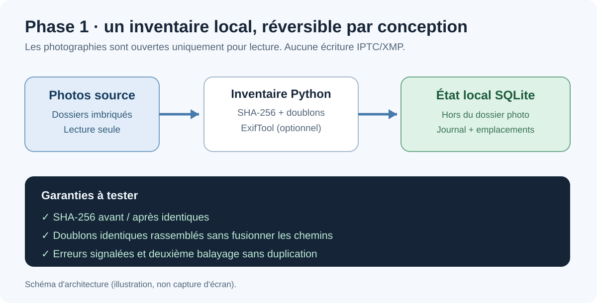
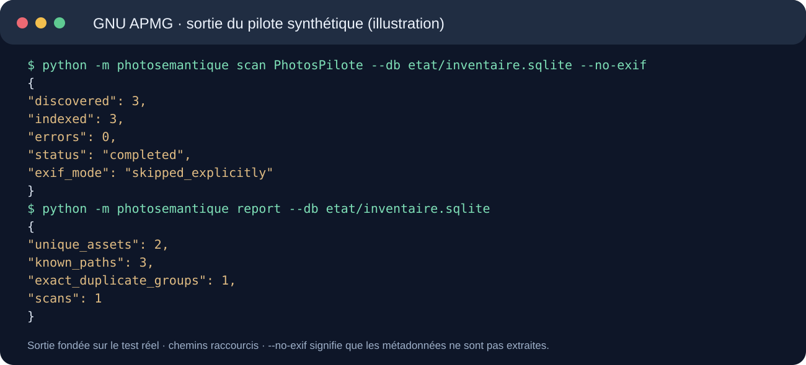
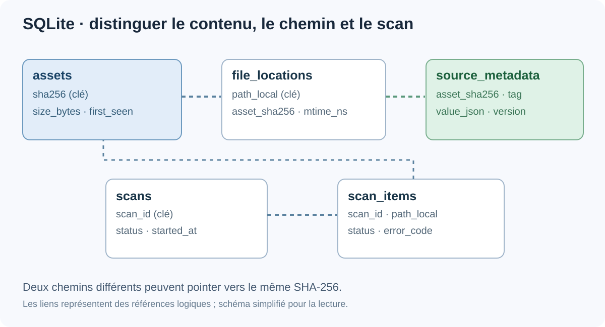
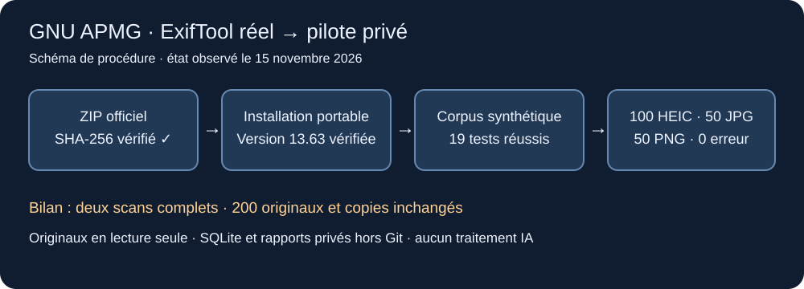

# Tutoriel illustré — Phase 1 : inventorier des photos sans les modifier

**Version :** `0.2.0a1` · **Public :** utilisateur Windows 11 / mainteneur · **Statut :** testé en local sur des fichiers fictifs ; intégration sur de vraies photos et ExifTool Windows à confirmer.

Ce tutoriel décrit les commandes réellement ajoutées, les résultats vérifiés et les limites connues. Les figures sont des **schémas SVG versionnés**, et la sortie de terminal est une **reconstitution abrégée d'un essai réellement exécuté sur trois fichiers synthétiques**, jamais une capture du poste de l'utilisateur.

## 1. Préparer une zone de travail séparée



1. Conserver le projet dans un dossier de code (ex. `C:\Dev\photosemantique`).
2. Conserver les photos dans un autre dossier (ex. `C:\Photos\Pilote`).
3. Conserver la base et les rapports dans un troisième dossier (ex. `C:\PhotoSemantique-Etat`).
4. Ne jamais placer photos, résultats, fichiers SQLite, manifestes JSONL ou données EXIF personnelles dans Git.

**Important :** le programme refuse d'écrire sa base SQLite ou le manifeste JSONL à l'intérieur de la racine source ou d'un dépôt Git détecté dans ses parents. Sous Windows, les liens symboliques et jonctions d'exploration sont ignorés. Ne pas lancer le pilote sur une copie personnelle du dépôt.

## 2. Vérifier Python et les contrôles du projet

Dans PowerShell, à la racine du dépôt :

```powershell
py --version
py -m photosemantique --version
py -m unittest discover -s tests -p 'test_*.py' -v
py scripts/check_repository.py
```

Le noyau Phase 1 n'utilise que la bibliothèque standard de Python. Il exige Python **3.12 ou plus récent**. Les métadonnées EXIF/IPTC/XMP nécessitent **ExifTool** en plus ; l'OCR et Ollama ne sont pas encore requis.

## 3. Installer et vérifier ExifTool

Télécharger ExifTool uniquement depuis [son site officiel](https://exiftool.org/), puis installer l'exécutable local selon les instructions du distributeur. On peut fournir son chemin directement à la commande ; aucun privilège administrateur Windows n'est requis pour le noyau Python.

```powershell
& "C:\Outils\ExifTool\exiftool.exe" -ver
```

Ce chemin est **un exemple** ; adaptez-le. Le pilote déclare une erreur si ExifTool manque, sauf lorsque `--no-exif` est demandé explicitement. Un scan `--no-exif` ne peut pas servir à certifier que les métadonnées ont été extraites.

## 4. Effectuer l'inventaire en lecture seule

```powershell
py -m photosemantique scan "C:\Photos\Pilote" `
  --db "C:\PhotoSemantique-Etat\inventaire.sqlite" `
  --jsonl "C:\PhotoSemantique-Etat\inventaire.jsonl" `
  --exiftool "C:\Outils\ExifTool\exiftool.exe"
```

Pour un **test sans ExifTool**, remplacer `--exiftool ...` par `--no-exif`. Le programme :

1. Recherche les candidats photo par extension, sans suivre les liens symboliques ;
2. Calcule SHA-256 sur les octets du fichier, sans le modifier ;
3. Lit les tags via ExifTool si activé, sans interpréter silencieusement les dates/GPS ;
4. Inscrit les contenus, chemins, versions et erreurs dans SQLite ;
5. Écrit éventuellement un manifeste JSONL **privé**, à l'extérieur du dossier source.

**Ne pas supposer que l'extension prouve qu'un fichier est une image valide.** L'extraction ExifTool et les tests réels servent précisément à détecter les fichiers malformés.

## 5. Comprendre les résultats



Le test reproduit ici a réellement recensé trois fichiers fictifs, dont une copie exacte : `discovered=3`, `indexed=3`, `unique_assets=2`, `exact_duplicate_groups=1`. ExifTool n'étant pas installé dans l'environnement de vérification, le test de bout en bout a utilisé `--no-exif` ; les tests d'intégration ExifTool utilisent une réponse simulée, non un binaire installé.

Pour demander un rapport sans afficher les chemins privés :

```powershell
py -m photosemantique report --db "C:\PhotoSemantique-Etat\inventaire.sqlite"
```

Le code de sortie est `0` si tout est inventorié, `2` si des fichiers ont une erreur (mais les autres continuent d'être traités), et `1` pour une erreur de configuration ou d'exécution. Le détail de chaque problème se trouve localement dans `scan_items`, sans publication.

## 6. Comprendre SQLite



- **`assets`** : un enregistrement par contenu SHA-256 ;
- **`file_locations`** : chaque chemin local pointant vers ce contenu ;
- **`scans`** et **`scan_items`** : exécutions, statuts, erreurs et reprise ;
- **`source_metadata`** : valeurs JSON de tags extraits, avec provenance ExifTool.

Deux fichiers de noms différents mais de contenu identique ne sont pas fusionnés physiquement : ils sont décrits par deux emplacements distincts.

## 7. Vérifier soi-même que les originaux n'ont pas changé

Pour le pilote privé, réaliser une empreinte indépendante **avant** et **après** le scan. Exemple PowerShell, à adapter :

```powershell
$source = 'C:\Photos\Pilote'
$etat = 'C:\PhotoSemantique-Etat'
New-Item -ItemType Directory -Force -Path $etat | Out-Null

Get-ChildItem -LiteralPath $source -File -Recurse |
  Get-FileHash -Algorithm SHA256 |
  Sort-Object Path |
  Select-Object Path, Hash |
  ConvertTo-Json -Depth 4 |
  Set-Content -LiteralPath "$etat\avant.json" -Encoding utf8

# Exécuter ensuite la commande scan, puis refaire le même calcul
# en remplaçant « avant.json » par « apres.json ».

Compare-Object (Get-Content "$etat\avant.json") `
               (Get-Content "$etat\apres.json")
```

Si la comparaison ne retourne aucune différence et que le contrôle des fichiers attendus est complet, les empreintes comparées sont identiques. Ce protocole n'élimine pas une modification qui aurait été exactement annulée entre les deux prises ; la séparation des droits de lecture/écriture sur les sources est une garantie supplémentaire recommandée.

## 8. Relancer après une erreur ou une interruption

Relancer exactement la commande `scan`. Une nouvelle entrée apparaît dans `scans`, mais les mêmes contenus SHA-256 et chemins ne sont pas dupliqués. Une interruption du programme marque le scan `interrupted` lorsqu'elle est capturable ; une coupure brutale de courant peut laisser l'état `running`, qui sera pris en charge par une procédure ultérieure de récupération.

Avant d'utiliser le résultat pour des archives importantes, vérifier l'espace disque disponible et sauvegarder la base de travail. Une base SQLite n'est pas une sauvegarde des photographies.

## 9. Ce qui reste à valider

- Test de bout en bout avec ExifTool **réel sur Windows 11** ;
- Formats RAW/HEIC spécifiques et dates EXIF complexes ;
- Volumes de 100 à 200 photographies réelles, qualité des erreurs et vitesse ;
- Comparaison indépendante des SHA-256 avant/après et scénario d'arrêt brutal ;
- Amélioration de la récupération des scans laissés `running` après arrêt du système ;
- Phase 2 : aucune analyse Qwen3-VL ou PaddleOCR n'a encore été intégrée.

Voir [ROADMAP.md](../../ROADMAP.md) pour les jalons, et [protocole pilote](../validation/pilot-protocol.md) pour les critères de sortie.


## 10. Reproduction Windows du 14 novembre 2026

1. Inspecter les entrées des deux ZIP et vérifier les chemins avant extraction. Leurs SHA-256 figurent dans ROADMAP.md.
2. Enregistrer le plan de reprise avant le code (`2df59b6`). Importer Phase 1, conserver les documents remplacés sous `docs/archive/` et préserver l'historique Git existant.
3. Adapter les intitulés à GNU APMG, conserver les avis de copyright originaux et le module `photosemantique`, ajouter la commande installable `gnu-apmg`.
4. Exécuter la suite de départ. L'accès restreint au dossier temporaire a d'abord empêché les essais ; avec cet accès autorisé, les tests ont révélé des connexions SQLite non fermées et une incohérence d'encodage des sous-processus.
5. Fermer explicitement les connexions de test et imposer UTF-8 pour les sous-processus. Ajouter deux régressions : refus des liens physiques pour la base et des collisions du manifeste avec les journaux SQLite.
6. Relancer : **19 tests exécutés, 17 réussis, 2 ignorés** faute de permission de création de liens symboliques. Les contrôles de structure et de cohérence NOTICE sont inclus dans la suite.
7. Effectuer deux scans CLI `--no-exif` sur trois fichiers d'octets synthétiques, dont deux identiques, puis consulter le rapport :

```json
{"unique_assets":2,"known_paths":3,"exact_duplicate_groups":1,"scans":2,"completed_scans":2,"partial_scans":0,"metadata_tags":0}
```

Les empreintes SHA-256 calculées indépendamment avant et après sont identiques. Aucun média personnel n'a été utilisé. Les fichiers temporaires du parcours CLI ont été nettoyés.


Les trois SVG sont des illustrations schématiques fournies avec l'archive, adaptées au nouveau nom ; ce ne sont pas des captures d'écran de ce PC. Le rapport JSON ci-dessus correspond au parcours réellement exécuté durant cette reprise.

ExifTool réel est absent du PATH. L'extraction EXIF n'est couverte ici que par des processus simulés ; elle reste à tester sur des images synthétiques valides puis sur le pilote privé. Le paquet installable, le GPU et la Phase 2 n'ont pas été testés.


## 11. ExifTool réel et pilote HEIC — bilan du 15 novembre 2026

### Préparer et installer

Les plans ont été enregistrés dans ROADMAP.md avant modification du code (commits `136e287` et `940289a`). La distribution Windows ExifTool 13.63 a été choisie depuis le site officiel, puis son SHA-256 comparé à `checksums-13.63.txt` :

```text
7a4bff4b1d6ee15adef882837847f76c0ed23228d294feed285939b6c9b293bd
```

Plusieurs liens SourceForge ont retourné une page HTML : ces réponses ont été rejetées. Le lien direct indiqué par la page a permis le téléchargement correct. La première extraction a échoué faute d'espace ; seuls les fichiers incomplets de cette tentative ont été supprimés. Après nettoyage du disque par l'utilisateur, l'archive a été extraite hors du dépôt. `exiftool(-k).exe` a été renommé `exiftool.exe`, en conservant son dossier `exiftool_files`. La commande `-ver` a retourné `13.63`. Le PATH global est inchangé.

### Vérifier avant les photos privées

Le nouveau test `tests/test_exiftool_real.py` construit trois PNG d'un pixel contenant un titre connu et une description UTF-8, ainsi qu'un JPEG volontairement tronqué. Il contrôle deux scans, les doublons, les tags attendus, les échecs et l'intégrité des octets.

Le premier essai réel a révélé deux comportements : un texte renommé JPG peut être reconnu comme texte, et un JPEG tronqué peut produire un tag Warning malgré un code de sortie 0. Le test utilise maintenant une vraie structure JPEG tronquée ; le lecteur marque les avertissements comme `metadata_failed` sans perdre l'empreinte du contenu. Cette politique conservatrice peut aussi signaler des avertissements bénins.

Les accents des noms Windows provoquaient un avertissement d'encodage. Le chemin est désormais transmis via l'entrée standard en UTF-8, avec `-charset filename=UTF8 -@ -`, plutôt que par l'encodage implicite de la ligne de commande. Un nom contenant un saut de ligne est refusé pour éviter toute ambiguïté dans ce format d'arguments. La documentation officielle décrit [l'encodage des noms](https://exiftool.org/exiftool_pod.html).

Pour relancer vous-même, depuis PowerShell à la racine du dépôt :

```powershell
& .\scripts\Test-ExifTool.ps1
```

Script exécuté et vérifié : **21 tests, 19 réussis, 2 ignorés**, dont le test ExifTool réel réussi. Les deux sauts concernent les permissions de liens symboliques. Le script traite seulement des données synthétiques et restitue le code de sortie des tests.

### Pilote privé et résultat agrégé

Le dossier indiqué par l'utilisateur a été inventorié sans afficher ses noms : 2 118 images éligibles, dont 1 335 HEIC. Pour respecter la taille du pilote, les premiers fichiers ordonnés par chemin relatif ont été retenus par format : 100 HEIC, 50 JPG et 50 PNG. Ce choix n'est pas un échantillonnage aléatoire.

Les originaux ont été hachés, copiés dans un état privé hors Git puis les copies vérifiées. Deux scans ont analysé ces copies avec le véritable ExifTool. Les originaux et les copies ont ensuite été rehachés indépendamment. Les fichiers OneDrive peuvent être téléchargés par le client de synchronisation lors de leur lecture ; le moteur n'a envoyé aucune image à une API.

| Format | Copies analysées | Indexées par scan | Erreurs |
| --- | ---: | ---: | ---: |
| HEIC | 100 | 100 | 0 |
| JPG | 50 | 50 | 0 |
| PNG | 50 | 50 | 0 |
| Total | 200 | 200 | 0 |

Deux scans terminés ; 200 contenus uniques ; aucun doublon exact dans cet échantillon ; 24 035 tags stockés. Cent tags de type de fichier HEIC confirmés. Contrôles SQLite `integrity_check` et clés étrangères réussis. **Zéro empreinte modifiée** sur les originaux et les copies. La partie scans et contrôle final a pris 79,7 secondes, hors préparation des copies.



Illustration vectorielle fondée uniquement sur ces métriques : elle ne contient aucune photo et ne constitue pas une capture de l'écran de l'utilisateur. Les copies, chemins, empreintes et données EXIF restent dans l'état privé ; ils ne sont pas versionnés.

### Portée de la compatibilité HEIC

La lecture de métadonnées et le hachage sont vérifiés pour ces 100 fichiers. Cela ne valide ni tous les HEIC/HEIF, ni leur décodage visuel, ni les miniatures, ni l'OCR/vision ou l'export. ExifTool répertorie HEIC/HEIF parmi les [formats pris en charge](https://exiftool.org/). Les étapes futures devront tester le décodage et traiter correctement orientation, couleurs et éventuelles images multiples.

Le [guide du pilote privé](../validation/pilot-runbook.md) décrit les conditions de relance ; aucune nouvelle analyse privée n'est déclenchée par le script de tests.
