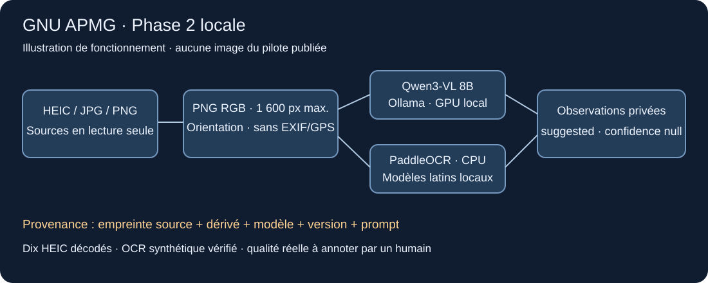

# Phase 2 — HEIC, vision locale et OCR

## 1. Planifier avant le code

La feuille de route Phase 2 a été enregistrée dans le commit `b64dd71`, puis la reprise après arrêt dans `0417114`. Le choix utilisateur est Qwen3-VL 8B, sans remplacement silencieux par un modèle déjà présent.

Les étapes : préparer les images, définir les propositions, vérifier les modèles locaux, tester sur une mire synthétique, puis sur quelques dérivés HEIC, mesurer et documenter. Aucun export sur les originaux n'est réalisé.



Ce schéma est une illustration vectorielle, pas une capture de photos personnelles.

## 2. Environnement isolé et modèles

L'environnement `.venv-phase2` utilise Python 3.13.6. Versions observées : Pillow 13.0.0, pillow-heif 1.8.1, jsonschema 4.26.0, PaddleOCR 3.7.0, PaddlePaddle 3.3.1. Le fichier `requirements-phase2-windows.lock.txt` fige les versions Python installées sur ce Windows ; ce n'est ni un audit juridique complet ni un verrouillage cryptographique des distributions.

Après manque de place sur C:, l'environnement du projet a été déplacé vers `D:\GNU-APMG-outils\python-phase2`, avec une jonction à son emplacement précédent. Les imports et les scripts ont été vérifiés après déplacement. Aucune autre installation n'a été déplacée. Le nettoyage général a précédé la reprise ; le téléchargement de Qwen3-VL a ensuite repris.

Depuis la racine du dépôt, le script d'installation est :

```powershell
& .\scripts\Setup-Phase2.ps1 -DownloadVisionModel -DownloadOcrModels
```

Ce script peut télécharger les dépendances et modèles ; il ne traite aucune photo. Sans les deux options, seuls les paquets Python sont installés. Il n'est pas relancé intégralement pendant cette reprise : les commandes d'installation sous-jacentes ont été exécutées et leurs imports vérifiés.

Modèles OCR : `PP-OCRv5_mobile_det` et `latin_PP-OCRv5_mobile_rec`, stockés dans le cache local PaddleX. Le premier téléchargement a basculé entre les hébergeurs référencés par PaddleX ; aucun média privé n'était impliqué dans cette préparation. L'analyse demande ensuite les dossiers explicites et bloque les connexions de sockets Python pendant import/inférence OCR. Cette protection n'est pas un pare-feu du système et ne bloque pas les autres applications.

## 3. Préparer les HEIC

Le module `photosemantique.phase2` lit l'image principale, applique l'orientation puis produit un PNG RGB réduit (grand côté de 1 600 pixels par défaut). Les profils ICC disponibles sont convertis vers sRGB ; en leur absence, le RGB est traité comme sRGB et cette hypothèse est inscrite dans le manifeste. Une image neuve reçoit seulement les pixels : pas de réinjection des métadonnées EXIF/XMP/GPS ou du profil source.

Les empreintes source sont comparées avant/après. Un manifeste privé conserve dimensions, nombre d'images, paramètres, versions et empreintes. La sortie doit être hors des sources et de Git ; les dossiers existants ne sont pas écrasés. Une erreur ne vaut pas réussite partielle silencieuse.

Dix copies HEIC du pilote précédent ont été décodées et réduites avec succès. Leur intégrité et l'absence de métadonnées dans les dix PNG ont été revérifiées. Chaque fichier de cet échantillon contenait une image. Le test synthétique JPEG avec orientation EXIF 6 vérifie aussi l'inversion des dimensions attendue.

Limites : dérivé de travail 8 bits, fidélité HDR non garantie, images secondaires ignorées ; pas de validation visuelle humaine de tous les tons/couleurs. Les images dépassant 50 millions de pixels sont refusées. Pour les HEIF multi-images, seule l'image principale est traitée ; ce cas réel reste à valider.

## 4. Propositions de vision et OCR

La vision contacte uniquement `127.0.0.1:11434`, sans proxy ni redirection. Elle exige un modèle GGUF installé, sa capacité vision et un digest stable avant/après. Aucun téléchargement de modèle n'est lancé par la commande d'analyse.

La réponse demandée comprend une description brève et au plus dix objets. Les réponses tronquées sont refusées. Le premier budget de 512 tokens a été épuisé par le raisonnement du modèle avant le JSON final, malgré `think=false`. Le budget est désormais 2 048 tokens ; les réponses restent bornées et validées. Les détails de raisonnement et les sorties complètes restent privés.

L'OCR fonctionne sur CPU. Le premier essai a échoué dans oneDNN (`ConvertPirAttribute2RuntimeAttribute`) ; `enable_mkldnn=False` a résolu ce cas sur l'installation observée. Les options d'orientation et de redressement OCR sont désactivées, les modèles requis étant fournis explicitement. Les boîtes sont exprimées dans les pixels du dérivé, pas de l'original.

Toutes les observations sont `suggested`, avec `confidence: null`. Le score OCR brut, non calibré, est séparé dans `raw_score`. Les empreintes des fichiers modèles OCR, la version, l'identité source et celle du dérivé assurent la provenance. Le schéma strict se trouve dans `photosemantique/schemas/phase2-observation.schema.json` ; le contrat v0 antérieur reste une référence de conception distincte.

## 5. Relancer sur une seule photo

Ouvrir PowerShell à la racine du dépôt. Adapter les chemins fictifs suivants et choisir un **nouveau dossier privé**, hors du dépôt et des sources :

```powershell
# Préparation seule, sans modèle :
& .\scripts\Invoke-Phase2.ps1 `
  -SourceFile 'D:\Photos\essai.heic' `
  -OutputDirectory 'D:\EtatPrive\essai-001'

# Préparation, puis vision et OCR séquentiels :
& .\scripts\Invoke-Phase2.ps1 `
  -SourceFile 'D:\Photos\essai.heic' `
  -OutputDirectory 'D:\EtatPrive\essai-002' -Vision -Ocr
```

Les dossiers modèles OCR par défaut sont dans le profil utilisateur ; utiliser `-DetectionModel` et `-RecognitionModel` pour d'autres emplacements. `-Model` permet de choisir un autre modèle déjà installé, sans modifier le choix par défaut Qwen3-VL 8B.

La préparation crée `prepared/image.png` et son manifeste. Les options produisent `vision.jsonl` et `ocr.jsonl`. Ces sorties sont privées ; ne jamais les déposer dans Git. La console affiche seulement statut, nombre d'observations et durée. Les erreurs sont résumées par type ; les diagnostics détaillés nécessitent un essai contrôlé local.

Le script a été vérifié sur la mire en préparation seule. Les appels Python d'OCR et de vision sont testés séparément ; la commande complète est à reproduire selon le bilan ci-dessous.

## 6. Validation et portée

La mire synthétique contient le texte connu « GNU APMG TEST 123 », un carré rouge et un disque bleu. L'OCR a retrouvé le texte attendu ; trois dérivés HEIC ont également produit des propositions de texte. Aucun nom, texte ou aperçu privé n'est reproduit ici.

La présence du texte attendu sur une mire n'est pas une mesure de CER/WER sur un corpus. Les descriptions privées et les textes OCR doivent être relus avant d'être considérés comme exacts. Pas de reconnaissance de personnes, pas de géocodage, pas d'export XMP, pas de validation humaine automatique.

Sources techniques primaires : [pillow-heif et métadonnées](https://pillow-heif.readthedocs.io/en/latest/pillow-plugin.html), [API Ollama](https://docs.ollama.com/api/generate), [PaddleOCR et chemins de modèles locaux](https://www.paddleocr.ai/latest/en/version3.x/pipeline_usage/OCR.html). Les résultats ci-dessus proviennent des essais locaux, pas de ces pages.


### Bilan des essais de cette reprise

| Contrôle | Résultat observé |
| --- | --- |
| Décodage et réduction HEIC | 10/10 ; intégrité inchangée ; PNG sans métadonnées |
| OCR de la mire | Texte attendu retrouvé ; 2 lignes proposées |
| OCR de trois dérivés HEIC | 3/3 exécutés ; 37 propositions à relire |
| Vision de la mire | Réponse structurée acceptée, 8,0 s |
| Vision de trois dérivés HEIC | 2/3 acceptés ; 1 refusé car réponse incomplète |
| Vision privée acceptée | 30,25 s et 16,43 s ; ces temps incluent chargement et déchargement |
| Vision privée refusée | 32,05 s ; budget épuisé sans JSON final ; aucune observation publiée |
| Pic GPU total observé | 8 693 MiB, échantillonné chaque seconde ; autres applications incluses |
| Tests locaux | 29 exécutés, 27 réussis, 2 ignorés |
| Construction du paquet | Wheel créée, nouveau schéma présent ; pas une release |

Le digest Qwen3-VL est `9cf69da2b16d097f7def535917c4b55a95d6c7ee5700eb69ab86b01b3cfca487`, via Ollama 0.40.13. La version locale continue à produire du raisonnement sur ces essais malgré `think=false` : ne pas supposer que ce réglage élimine ce coût. Le cas privé tronqué a été reproduit ; les contenus détaillés ne figurent pas dans Git. Une réponse refusée renvoie `error_code: incomplete_response`.

La suite comprend notamment orientation, retrait de métadonnées, non-écrasement, sorties hors sources/Git, altération du dérivé, refus de modèle distant/absent, réponse non conforme, réponse tronquée et provenance. Les deux sauts locaux concernent les liens symboliques.

Les résultats montrent un fonctionnement technique préliminaire, pas une précision établie. La prochaine étape est de relire localement un échantillon, transcrire la vérité terrain et distinguer omissions, inventions et lectures incorrectes. Aucun score CER/WER ou précision/rappel n'est calculé sans cette référence. Le pilote de vision n'est pas déclaré complètement réussi.
