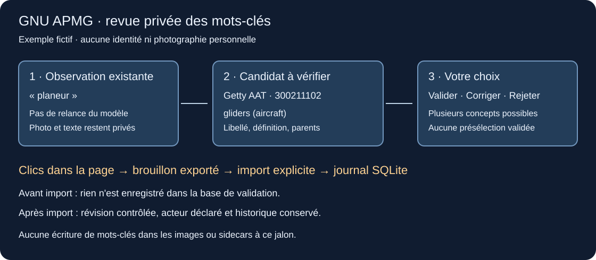

# Revue privée des mots-clés — GNU APMG

## 1. Planifier et distinguer les étapes

Le jalon V a été enregistré dans ROADMAP.md au commit `c1a5ba4` avant le code. Il relie les observations existantes aux concepts puis conserve les décisions humaines, sans relancer l'IA ni modifier les images.



Ce schéma est une illustration fictive : aucune photo, description ou identité privée n'y est reproduite.

## 2. Construire des candidats, pas des certitudes

Le rapprochement lit les observations de type `object`. Il cherche des libellés FR/EN et quelques alias explicitement révisés, avec des frontières de mots : « avion » ne correspond pas à « avionique ». Les concepts IPTC retirés sont exclus. Des thèmes sensibles (branches santé, religion et société) sont laissés au choix manuel. Description et OCR sont affichés comme contexte ; ils ne déclenchent pas le rapprochement automatique.

Exemple fictif : `planeur` propose Getty AAT `300211102`, `gliders (aircraft)`. Le planeur de mobilier n'est pas introduit comme synonyme. Le libellé, la définition, la source et les parents permettent de choisir le sens. La correspondance lexicale n'est pas une probabilité et ne crée pas d'exactMatch entre vocabulaires.

Le rapprochement est volontairement limité au vocabulaire embarqué et à quelques alias ; aucun candidat n'est aussi un résultat normal. La recherche manuelle offre les concepts actifs du snapshot, y compris les thèmes que l'automatisme ne propose pas.

## 3. Créer une session privée

Depuis PowerShell à la racine du dépôt, adapter ces chemins fictifs :

```powershell
& .\scripts\New-KeywordReview.ps1 `
  -Observations @('D:\EtatPrive\photo-01-vision.jsonl', 'D:\EtatPrive\photo-01-ocr.jsonl') `
  -PreparedDirectory @('D:\EtatPrive\photo-01-prepared') `
  -SessionDirectory 'D:\EtatPrive\revue-001' -Open
```

Le nouveau dossier contient `review.sqlite` et `review.html`. Il doit être hors des sources et de Git. L'aperçu est facultatif et provient seulement d'un dérivé PNG vérifié par son manifeste ; aucun original n'est transformé pour cette étape. Les analyses originales sont conservées dans la session avec leur provenance ; leurs fichiers ne sont pas réécrits.

`-Open` ouvre la page dans le navigateur choisi par Windows. Sans cette option, ouvrir `review.html` par double-clic. Ce n'est pas une page publique : elle peut embarquer aperçus, textes, descriptions et identifiants privés. Ne pas la partager ou la placer sur un hébergement web.

## 4. Accepter, corriger, rejeter

Pour chaque objet proposé :

1. Examiner la photo et, si nécessaire, ouvrir « Descriptions, texte OCR et provenance ».
2. Lire les concepts candidats et leurs définitions. Aucun mot-clé n'est validé par défaut.
3. Cocher un ou plusieurs concepts pertinents. « Retirer » enlève un choix du brouillon, sans effacer l'historique.
4. Si nécessaire, rechercher un autre concept par un mot français/anglais et le sélectionner : cela constitue une correction manuelle.
5. Cliquer sur **« Valider ces mots-clés »** ou **« Rejeter la proposition »**. Une note privée est facultative.
6. Toute modification de sélection ou de note après confirmation annule cette confirmation en attente ; confirmer à nouveau avant export.

On peut laisser un objet sans décision. Un rejet vise la proposition de mot-clé, pas les octets de la photo ni le texte du modèle. Plusieurs mots-clés peuvent être associés à une observation et plusieurs observations à la même photo. S'il n'existe aucune observation d'objet, la page affiche ce manque au lieu d'inventer des propositions depuis l'OCR.

## 5. Exporter puis importer les décisions

Cliquer **« Exporter mes décisions »**. Le navigateur télécharge un JSON dont le nom contient l'identifiant de session et sa révision. L'export est un brouillon : il ne modifie pas SQLite. Il contient uniquement les changements confirmés de cette page, pas les photos ou l'ensemble du catalogue.

Importer ensuite ce fichier explicitement :

```powershell
& .\scripts\Import-KeywordDecisions.ps1 `
  -SessionDirectory 'D:\EtatPrive\revue-001' `
  -DecisionsFile 'C:\Telechargements\gnu-apmg-decisions-EXEMPLE-r0.json' `
  -Actor 'moi'
```

Adapter le chemin au fichier réellement téléchargé. Le champ acteur est une déclaration locale, pas une identité authentifiée. Le script contrôle le lot, l'importe, régénère la page et affiche le nombre de décisions. **Fermer puis rouvrir la page** avant de poursuivre, pour charger la nouvelle révision. Un ancien onglet ne se met pas à jour automatiquement.

Le même fichier réimporté avec le même acteur est reconnu comme déjà appliqué. Un lot différent provenant d'une ancienne révision est refusé. Un lot contenant une observation inconnue, un concept inconnu/retiré, un doublon ou une sélection incohérente est rejeté en entier : aucune demi-validation.

Si la régénération HTML échoue après un import réussi, on peut la relancer sans modifier les décisions :

```powershell
& .\.venv-phase2\Scripts\python.exe -m photosemantique.review render 'D:\EtatPrive\revue-001'
& .\.venv-phase2\Scripts\python.exe -m photosemantique.review status 'D:\EtatPrive\revue-001'
```

## 6. Historique et confidentialité

Chaque lot accepté ajoute de nouveaux événements : observation, choix de concepts, action, acteur déclaré, note, date et révision. Une correction ultérieure laisse les événements précédents en place ; le dernier événement donne l'état courant. Les textes initiaux du modèle restent inchangés. L'interface ne modifie pas la taxonomie publique.

L'historique est append-only **via l'application**, pas une preuve cryptographique ou une protection contre l'édition directe du fichier SQLite. Pas de serveur HTTP, de CDN ni de requête de modèle dans cette page. Une politique CSP bloque les connexions et ressources externes ; les aperçus sont des données PNG embarquées. Les textes sont insérés comme texte DOM, sans exécution de HTML issu du modèle.

Une modification du snapshot de vocabulaire exige une nouvelle session et une future procédure de migration à définir ; les anciennes validations ne sont pas silencieusement réinterprétées.

## 7. Essais de ce jalon

- Session réelle : **47 observations**, dont **15 objets**, issues des deux photos déjà décrites et de leur OCR ; **3 objets ont au moins un candidat lexical**. Deux aperçus réduits sont embarqués. **Zéro décision réelle enregistrée** ; aucune proposition n'a été acceptée à la place de l'utilisateur.
- Démonstration fictive « planeur » : tests DOM de sélection, invalidation après modification, acceptation, rejet, recherche manuelle, correction et export JSON. Le script d'import a appliqué une correction fictive et la session réelle est restée à révision 0.
- L'accès au navigateur de test était indisponible au lancement. Les interactions ont été vérifiées dans un DOM simulé avec jsdom, pas par une inspection visuelle de navigateur ; aucune capture réelle n'est revendiquée. jsdom est un outil de test installé hors dépôt, pas une dépendance du produit.
- Tests backend : transactions, historique, rejouabilité, révisions obsolètes, changement de vocabulaire, homonymes, frontières de mots, contenus HTML malveillants, identités et sorties privées.

Les mots-clés ne sont pas encore écrits dans les images ou sidecars XMP. L'export documentaire et la migration des décisions entre sessions restent des jalons distincts.


Suite locale complète : **47 tests exécutés, 45 réussis, 2 ignorés** pour restrictions de liens symboliques. Les tests de décisions n’utilisent que des données synthétiques.
