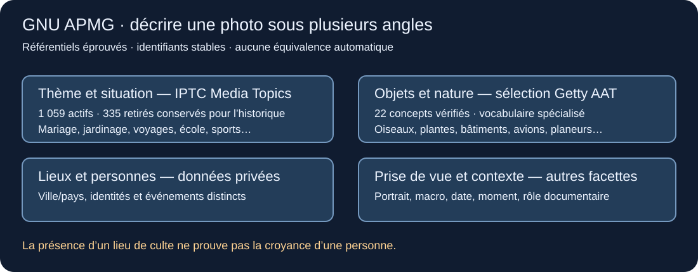

# Taxonomie personnelle avec des référentiels éprouvés

## 1. Plan avant travail

Le commit documentaire `09c2ef5` a enregistré le jalon T avant import et développement. La demande est une taxonomie précise pour les photographies de la vie personnelle, en réutilisant le plus possible des standards et vocabulaires existants.



Le schéma est une illustration, sans photo personnelle ni donnée du pilote.

## 2. Récupérer les sources et conserver les droits

IPTC Media Topics a été consulté sur son serveur officiel et ses conditions CC BY 4.0 vérifiées. Le JSON multilingue de version **30 septembre 2026** est conservé sans réécriture dans `third_party/vocabularies/iptc-mediatopics.json`. Les tentatives HTTPS locales ont été réinitialisées ; le point d'accès HTTP officiel a fonctionné. Son empreinte SHA-256 locale est figée dans `provenance.json`, sans prétendre disposer d'une signature de l'éditeur.

Getty AAT a été interrogé publiquement via SPARQL. Les premières requêtes trop larges ont été rejetées ou tronquées ; seules des réponses JSON complètes ont été retenues. Requêtes et réponses finales sont conservées. La licence ODC-By 1.0 et la citation Getty sont dans le README des sources et NOTICE. La GPL du code ne remplace aucune de ces deux licences de données.

Cette acquisition de données publiques n'a nécessité aucune photo, nom privé, coordonnée ou observation du pilote.

## 3. Contrôler les retraits, les langues et le sens

Le snapshot IPTC contient **1 394 concepts : 1 059 actifs et 335 retirés**. Les retirés restent accessibles pour historique mais ne sont pas proposés par la recherche normale. Parmi les actifs, 37 n'ont pas de libellé français dans la source ; l'anglais est affiché explicitement.

Deux concepts IPTC peuvent avoir le même libellé français : « Mariage » comme institution et « Mariage » comme cérémonie ont des identifiants différents. Un premier choix de vue incluait « Tourisme », désormais retiré ; le validateur l'a refusé et la vue utilise seulement la branche active « Voyages ».

Getty a illustré le risque des homonymes : gliders de mobilier et planeurs, birds décoratifs ou équipements et oiseaux, plants industriels et plantes vivantes. Après examen, une sélection de **22 concepts** est retenue avec identifiants, libellés anglais, définitions et parents disponibles. Les noms français d'affichage sont des traductions éditoriales GNU APMG clairement séparées, pas des traductions officielles Getty. Les parents extérieurs au fragment restent des références externes, sans racines inventées.

## 4. Consulter la taxonomie

Ouvrir [le catalogue HTML](../ontology/catalogue.html) par double-clic dans un navigateur. Il ne télécharge ni police, ni image, ni script ; tout le catalogue est local.

1. Saisir un mot français ou anglais, par exemple `mariage`, `jardinage`, `birthday`.
2. Choisir une des **17 vues de vie personnelle** : famille, école, travail, maison, repas, voyages, nature, sports, loisirs, culture, sciences, cérémonies, croyances, santé, incidents, transports ou météo.
3. Lire le parent officiel et l'identifiant du concept ; les vues ne remplacent pas la hiérarchie IPTC.
4. Inclure les termes retirés seulement pour explorer l'historique. Les vues personnelles sont construites sur les concepts actifs.

Le catalogue HTML porte sur IPTC ; les 22 compléments d'objets Getty sont consultables dans [la sélection Getty](../ontology/GETTY-SELECTION.md) et via la commande dédiée ci-dessous.

Le [guide de photographie personnelle](../ontology/TAXONOMIE-PERSONNELLE.md) explique les facettes, les exemples de vie et les pièges. Il distingue les sujets visibles, les activités, les événements, les personnes privées, les lieux, le temps, la forme de prise de vue et le rôle documentaire. Toutes ces facettes ne sont pas déjà implémentées comme champs d'annotation.

## 5. Rechercher et reconstruire sans réseau

Depuis PowerShell à la racine du dépôt :

```powershell
python -X utf8 -m photosemantique.taxonomy mariage
python -X utf8 -m photosemantique.taxonomy planeur --source getty
python -X utf8 scripts/build_taxonomy.py --check
```

La commande de reconstruction `python scripts/build_taxonomy.py` relit les sources figées, vérifie leurs empreintes et génère les JSON de consultation, le SKOS/Turtle, les catalogues Markdown et HTML. Elle ne contacte aucun serveur. `--check` détecte les fichiers dérivés obsolètes sans les modifier.

Le résultat n'attribue aucun mot-clé aux photos. Aucun lien exactMatch IPTC–Getty n'a été créé. L'identification des espèces, les identités familiales et le géocodage exigent d'autres référentiels ou des données privées et une validation séparée.

## 6. Vérifications

Tests de référence : unicité des identifiants, fermeture et absence de cycles IPTC, retrait des concepts obsolètes, distinction des deux « Mariage », sélection du planeur aéronautique, régénération déterministe et parsing réel du Turtle avec RDFLib. Les tests restent sans réseau ni photographies.

Sources : [IPTC Media Topics](https://iptc.org/standards/media-topics/), [SKOS W3C](https://www.w3.org/TR/skos-primer/), [Getty AAT et données](https://www.getty.edu/research-conservation/tools-databases/vocabularies/data-services/). Le catalogue est une base évolutive ; il ne prétend pas couvrir toutes les espèces et tous les objets de la vie humaine.


Bilan local : 35 tests exécutés, 33 réussis, 2 ignorés (liens symboliques). Le catalogue contient 1 394 lignes et 17 vues ; sa structure HTML et la syntaxe de son JavaScript ont été contrôlées, sans prétendre à une inspection visuelle dans un navigateur. Les 17 sommets officiels sont préservés à partir des métadonnées du schéma, sans transformer un concept sans parent en nouvelle racine.


Publication : commit `76552d3`. Les [contrôles GitHub Windows et Linux](https://github.com/steveprudhomme/gnu-apmg/actions/runs/43694140453) ont réussi. Les attributs Git préservent les octets des sources publiques, y compris leurs espaces de fin de ligne, afin de ne pas invalider les empreintes d’origine lors du clonage. Les cinq fichiers sources indexés ont été vérifiés contre la provenance.
