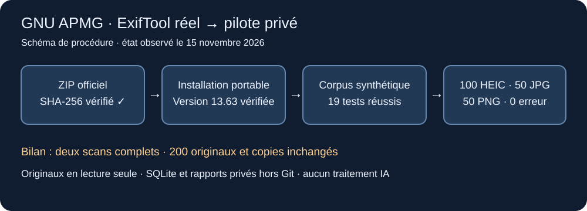

# Pilote privé — préparation et conditions de lancement

Ce guide décrit la relance privée. Un premier pilote de 200 copies, dont 100 HEIC, a été validé ; voir le tutoriel pour le résultat agrégé. Le dossier source et les sorties doivent être confirmés pour toute nouvelle exécution.

## 1. Conditions préalables

- Disposer d'assez d'espace pour ExifTool, la base et les rapports. Une première extraction a échoué faute de place, puis l'installation a réussi après nettoyage ; le ZIP nécessite 34 674 174 octets décompressés, sans compter les autres besoins du système.
- Réussir d'abord le test ExifTool réel décrit dans le tutoriel (réussi lors de la validation du 15 novembre 2026).
- Fournir explicitement le dossier pilote (100 à 200 photos) et le dossier de sortie privé. Le second doit être hors du répertoire photographique et hors de tout dépôt Git.
- Conserver une sauvegarde indépendante des originaux. Ne pas déplacer ni réorganiser les sources durant le scan.

## 2. État de référence indépendant

Relever le nombre de fichiers éligibles et leurs empreintes SHA-256 avant l'analyse. Le tutoriel Phase 1 fournit une commande PowerShell. Conserver ce relevé dans le dossier privé de sortie, jamais dans le dépôt. Les fichiers non pris en charge ne doivent pas être comptés comme des erreurs d'inventaire : comparer les extensions avec la liste de `photosemantique/inventory.py`.

Noter localement la version Python, la version ExifTool, les permissions de lecture et l'espace disque disponible. Les noms et chemins, dates, personnes et GPS sont privés.

## 3. Analyse et contrôles

Exécuter `scan` avec `--exiftool` explicite, sans `--no-exif`, puis `report`. Les modèles de commandes sont dans INSTALL.md ; remplacer les chemins d'exemple par les dossiers confirmés. Ne pas lancer de commande d'écriture ExifTool sur le corpus privé.

Comparer les empreintes après analyse au relevé préalable ; vérifier le nombre de fichiers découverts et examiner les erreurs individuelles dans SQLite localement. Un code de sortie 2 signifie résultat partiel, pas validation du pilote. Un doublon exact est un contenu identique, pas une photo simplement ressemblante.

Arrêter et diagnostiquer en cas de modification des sources, de manque d'espace, d'erreur d'accès systématique, de nombre de fichiers inexpliqué ou de sortie placée dans les sources. Toute erreur doit être comprise avant de déclarer le pilote validé.

## 4. Compte rendu autorisé

Seuls les nombres agrégés, versions et conclusions sans identifiants privés peuvent être repris dans la documentation publique. Les bases SQLite, manifestes, relevés d'empreintes, copies de photos et journaux restent locaux. La réussite du pilote n'autorise pas automatiquement la Phase 2 ni l'écriture de métadonnées.

